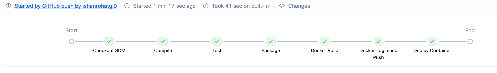
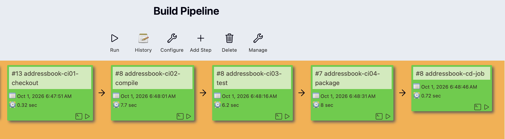
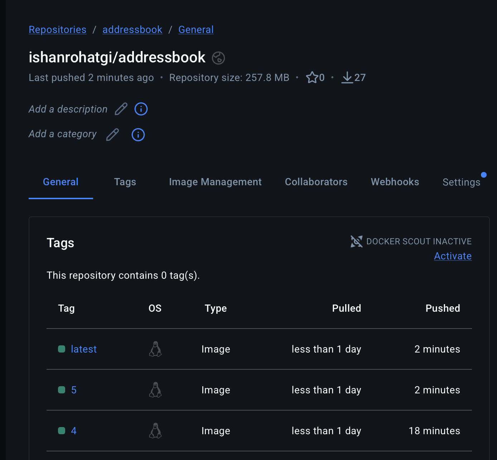
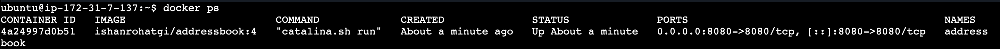
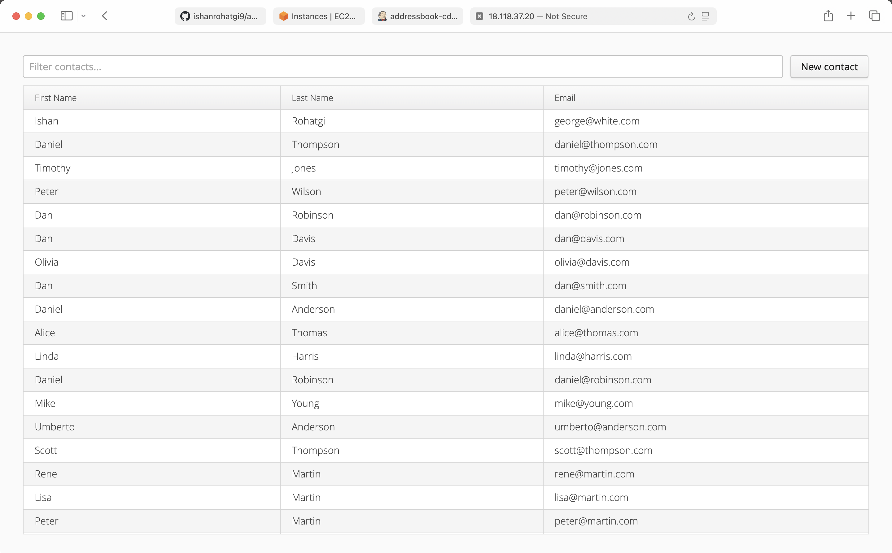

# AddressBook - CI/CD Pipeline with Jenkins and Docker

A Java web application deployed through a CI/CD pipeline using Jenkins and Docker. The project started with Jenkins Freestyle jobs and was later updated to use Pipeline as Code with a `Jenkinsfile` and Docker-based deployment on AWS EC2.

## CI/CD Workflow

```text
Developer
    |
    v
  GitHub
    |
    v
Jenkins Pipeline (Jenkinsfile)
    |
    v
Compile → Test → Package WAR
    |
    v
Docker Build → Docker Hub
    |
    v
Deploy Container on AWS EC2
    |
    v
Running Application
```

The pipeline automates application compilation, testing, WAR packaging, Docker image creation, image publishing, and container deployment.

## Pipeline Stages

- **Compile:** Compile the Java application using Maven.
- **Test:** Run the application's JUnit tests.
- **Package:** Package the application as a WAR file.
- **Docker Build:** Build a Docker image containing the application.
- **Docker Push:** Publish the image to Docker Hub.
- **Deploy:** Run the application container on the EC2 deployment host.

## Docker Deployment

The application is packaged as a WAR and runs inside a Docker container.

- **Container name:** `addressbook`
- **Port mapping:** `8080:8080`
- **Application path:** `/addressbook/`

The Docker image is published to Docker Hub and used to deploy the application on AWS EC2.

## Application

The project uses a Java AddressBook web application containing:

- Contact management classes
- AddressBook logic
- Web UI
- Maven build configuration
- JUnit tests

The application is packaged as:

```text
target/addressbook.war
```

## Technologies

- Java
- Maven
- JUnit
- Git and GitHub
- Jenkins Pipeline
- Jenkinsfile
- Docker
- Docker Hub
- Apache Tomcat
- AWS EC2
- Linux
- Bash
- CI/CD

## Screenshots

### Jenkins Pipeline



### Earlier Jenkins Freestyle Jobs



### Docker Hub Image



### Running Docker Container



### AddressBook Application



## Project Structure

```text
addressbook/
├── src/
│   ├── main/
│   └── test/
├── Dockerfile
├── Jenkinsfile
├── pom.xml
├── .gitignore
├── addressbook_screenshot.png
└── docs/
    ├── jenkins-pipeline.png
    ├── jenkins-freestyle-jobs.png
    ├── dockerhub-image.png
    └── docker-container.png
```

## What I Learned

- Migrating from Jenkins Freestyle jobs to Pipeline as Code.
- Automating Maven builds, testing, and WAR packaging.
- Building and publishing Docker images.
- Deploying containerized applications on AWS EC2.
- Managing CI/CD stages using a Jenkinsfile.
- Working with Docker containers and port mappings.

## Future Improvements

- Add automated Docker image vulnerability scanning.
- Implement deployment rollback handling.
- Integrate notifications for build and deployment failures.
